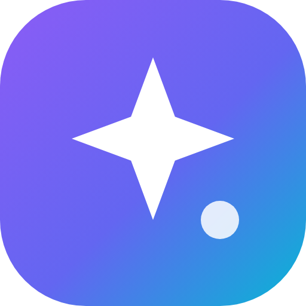

<div align="center">


# Nova AI Hub · نوا AI هاب

**همه هوش‌های مصنوعی، یک جا** — Every AI, one place

چت با همه مدل‌ها · ساخت عکس و ویدیو · محیط کدنویسی شبیه VS Code با هوش مصنوعی · پرووایدر سفارشی · مدل‌های رایگان
فارسی (پیش‌فرض) و انگلیسی · تم تاریک و روشن · وب، ویندوز و اندروید

[⬇️ دانلود آخرین نسخه / Download latest release](../../releases/latest)
</div>

---

## دانلود
| پلتفرم | فایل |
|---|---|
| ویندوز (نصبی) | `Nova-AI-Hub-Setup-x.y.z.exe` |
| ویندوز (پرتابل، بدون نصب) | `Nova-AI-Hub-Portable-x.y.z.exe` |
| اندروید | `Nova-AI-Hub-vx.y.z.apk` |
| وب / سرور | سورس همین مخزن: `node server.js` |

همه فایل‌ها در بخش [Releases](../../releases) هستند.

## امکانات
- **پرووایدرها**: بیش از ۲۵ سرویس آماده: OpenAI، Anthropic Claude، Google Gemini، Moonshot Kimi، DeepSeek، xAI Grok، OpenRouter، Mistral، Groq، Together، Fireworks، Perplexity، Cohere، Qwen، GLM، Cerebras، SambaNova، NVIDIA NIM، Hugging Face، GitHub Models، Novita، SiliconFlow، Ollama، LM Studio، Pollinations.
- **پرووایدر سفارشی**: هر API سازگار با OpenAI / Anthropic / Gemini با Base URL و هدر دلخواه.
- **دریافت خودکار مدل‌ها** با یک دکمه و **تشخیص خودکار قابلیت‌ها** (چت، دید، ساخت تصویر، ساخت ویدیو) + بررسی زنده. افزودن دستی مدل و تغییر قابلیت‌ها.
- **چت**: استریم، نمایش استدلال مدل، Markdown و کد، پیوست عکس و فایل، دستور سیستمی، مقایسه همزمان تا ۳ مدل، کتابخانه پرامپت.
- **کدنویسی (شبیه VS Code)**: یک پوشه از سیستم انتخاب کن؛ درخت فایل‌ها، ادیتور با رنگ‌بندی کد و تب‌ها، ترمینال، و دستیار هوش مصنوعی که **فایل‌های پروژه را مستقیم داخل همان پوشه می‌سازد، ویرایش یا حذف می‌کند**.
- **استودیو تصویر و ویدیو**: FLUX، DALL·E / GPT-Image، Imagen، Veo، Sora و هر مدل تصویرساز دیگر + بهبود پرامپت با هوش مصنوعی.
- **مدل‌های رایگان**: Pollinations بدون کلید و لیست زنده مدل‌های رایگان OpenRouter.
- گالری، پشتیبان‌گیری و بازیابی، نصب به‌صورت PWA.
- **حساب‌های کاربری و پنل مدیریت** (فقط ادمین): آمار زنده، مدیریت کاربران (ساخت، تأیید، مسدود، حذف، تغییر رمز، نقش)، سهمیه روزانه پیام/تصویر/ویدیو برای هر کاربر، محدود کردن مدل‌ها، دستگاه‌ها و نشست‌ها (خروج اجباری)، قوانین ثبت‌نام (بسته / با تأیید / آزاد)، اطلاعیه، حالت تعمیر، پیام همگانی، گزارش فعالیت و تنظیم ربات تلگرام.
- **همگام‌سازی زنده بین همه نسخه‌ها**: وب، ویندوز، اندروید و ربات تلگرام به یک سرور وصل‌اند. پرووایدری که از هر جا (حتی از داخل ربات) اضافه شود، فوراً همه‌جا در دسترس است.

## اجرا از سورس (وب)
```bash
node server.js          # Node.js 18+  →  http://localhost:3000
```
هیچ وابستگی‌ای لازم نیست. کلیدهای API فقط روی سیستم خودت در پوشه `data/` ذخیره می‌شوند.

| متغیر | کاربرد |
|---|---|
| `PORT` | پورت (پیش‌فرض 3000) |
| `HOST` | پیش‌فرض `127.0.0.1`. برای دسترسی از گوشی یا شبکه: `0.0.0.0` |
| `APP_PASSWORD` | کد راه‌اندازی اولین حساب ادمین (اگر نگذاری و سرور عمومی باشد، یک کد تصادفی در کنسول چاپ می‌شود) |
| `TELEGRAM_BOT_TOKEN` | روشن کردن ربات بدون رفتن به پنل |
| `DISABLE_FS` | `1` = غیرفعال کردن کامل دسترسی به پوشه و ترمینال سرور (به‌طور پیش‌فرض فقط ادمین دارد) |
| `DATA_DIR` | محل ذخیره داده‌ها |

Docker: `docker build -t nova . && docker run -p 3000:3000 -e APP_PASSWORD=setup-code -v $PWD/data:/app/data nova`

### اولین اجرا
اولین کسی که برنامه را باز می‌کند حساب **ادمین** را می‌سازد (روی سرور عمومی، کد راه‌اندازی لازم است). بعد از آن فقط ادمین به بخش «مدیریت» دسترسی دارد. نسخه‌های قبلی هنگام ارتقا داده‌هایشان (گفتگوها، رسانه‌ها، پرووایدرها) را به حساب ادمین منتقل می‌کنند.

## همه نسخه‌ها روی یک سرور (همگام)
برای اینکه وب، ویندوز، اندروید و ربات یکی باشند، سرور نوا را روی یک VPS (یا یک کامپیوتر همیشه‌روشن) اجرا کن:
- **وب**: آدرس سرور را در مرورگر باز کن.
- **ویندوز**: در صفحه ورود یا «تنظیمات ← آدرس سرور» گزینه «سرور مشترک» را بزن و آدرس را وارد کن. حالت «همین کامپیوتر» یک سرور جدا روی همان سیستم اجرا می‌کند.
- **اندروید**: در اولین اجرا آدرس سرور را بزن.
- **تلگرام**: در «مدیریت ← ربات تلگرام» توکن را بزن. هر کاربر از «تنظیمات ← اتصال تلگرام» کد می‌گیرد و در ربات `/link کد` می‌فرستد (یا `/login نام‌کاربری رمز`).

پیشنهاد: سرور را پشت HTTPS (مثلاً Caddy یا Nginx) قرار بده.

## اندروید
اپ اندروید به سرور نوا وصل می‌شود (تا پرووایدرها، مدل‌ها و گفتگوها همه‌جا یکی باشند):
1. روی کامپیوتر یا VPS اجرا کن: `HOST=0.0.0.0 node server.js`
2. در اپ آدرس `http://IP-کامپیوتر:3000` یا آدرس سرورت را بزن.

## ساخت نسخه‌ها
- ویندوز: `npm install && npm run dist:win`
- اندروید (بدون Gradle): `android/build-apk.sh` (راهنما داخل فایل)
- با هر تگ `v*` گیت‌هاب اکشن خودکار نسخه ویندوز و اندروید را می‌سازد و در Releases قرار می‌دهد.

## ساختار
```
server.js        سرور (بدون وابستگی) و API
presets.js       لیست سرویس‌ها (برای افزودن سرویس یک خط اضافه کن)
accounts.js      حساب‌ها، نشست‌ها، سهمیه‌ها، آمار و همگام‌سازی زنده
bot.js           ربات تلگرام (داخل همین سرور)
public/          رابط کاربری (چت، کدنویسی، استودیو، …)
desktop/         نسخه دسکتاپ (Electron)
android/         نسخه اندروید
```

## ربات تلگرام
ربات داخل همین سرور اجرا می‌شود و با وب‌اپ یک داده‌ی مشترک دارد: پرووایدرها، مدل‌ها و گفتگوها (گفتگوهای تلگرام در وب‌اپ با علامت ✈️ دیده می‌شوند).

1. در تلگرام به `@BotFather` برو، `/newbot` بزن و توکن را بگیر.
2. در برنامه: **مدیریت ← ربات تلگرام**، توکن را بزن و «اتصال و روشن کردن ربات» را بزن.
3. دسترسی: «فقط حساب‌های نوا» (هر کاربر حسابش را با `/link کد` یا `/login` وصل می‌کند) یا «همه» (برای هر کاربر تلگرام خودکار حساب ساخته می‌شود). سهمیه‌ها و محدودیت مدل‌ها در ربات هم اعمال می‌شوند.
4. **ادمین داخل ربات**: `/admin` یا دکمه «پنل مدیریت» ← آمار، مدیریت کاربران (تأیید/مسدود)، افزودن پرووایدر با کلید (پیام کلید بعد از خواندن پاک می‌شود)، فعال/غیرفعال/حذف پرووایدر، دریافت دوباره مدل‌ها، حالت تعمیر و پیام همگانی.

یا با متغیر محیطی: `TELEGRAM_BOT_TOKEN=... node server.js`

امکانات ربات: گفتگو با همه‌ی مدل‌ها (پاسخ زنده)، انتخاب مدل با دکمه، ساخت تصویر (`/image`)، تحلیل عکس با مدل‌های دارای دید، فرستادن فایل متنی و کد، فارسی/انگلیسی.

> ربات فقط وقتی کار می‌کند که سرور روشن باشد (روی PC، یا بهتر روی یک VPS). اگر سرور به `api.telegram.org` دسترسی ندارد، در بخش «پیشرفته» آدرس یک پروکسی بگذار.

---
**English** — Nova AI Hub is a self-hosted, zero-dependency AI hub: add any provider (or a custom OpenAI/Anthropic/Gemini-compatible endpoint), fetch models with one click, auto-detect image/video capabilities, chat with every model, generate images & videos, and code with an AI agent that writes files straight into a folder you pick (VS Code-style explorer, editor and terminal). Accounts with an admin dashboard (users, daily limits, allowed models, sessions, registration rules, announcements, maintenance mode, broadcast, activity log). Web, Windows, Android and the built-in Telegram bot connect to one server and stay in sync live; the admin can manage providers from any of them, including inside the bot (/admin). Windows and Android builds are in [Releases](../../releases). License: MIT.
